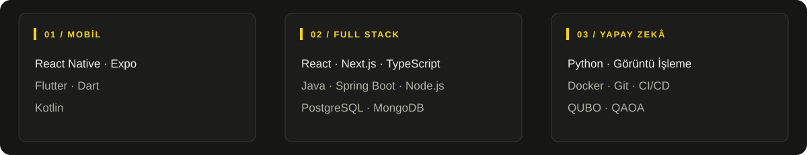
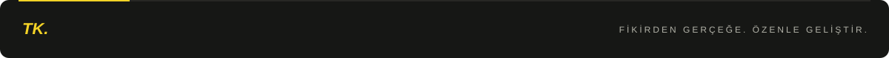

  
  

  

  
  
  
  

 

### TK'nın arkasındaki geliştirici.

Ben **Taha Göktuğ Karaca**. **Mobil, web ve akıllı sistemler** alanlarında ürünler geliştiriyorum. Görünümünden çalışma biçimine ve canlı ortam performansına kadar deneyimin her aşamasına önem veriyorum.

- **Mobil** — React Native, Expo ve Flutter ile platformlar arası uygulamalar.
- **Full stack** — birlikte çalışan arayüzler, API'ler ve gerçek zamanlı servisler.
- **Uygulamalı yapay zekâ** — görüntü işleme ve veriyi kullanışlı kararlara dönüştüren araçlar.
- **Keşfettiklerim** — etkileşimli 3D deneyimler ve hibrit kuantum optimizasyonu.

 

### Kullandığım teknolojiler.

 

 

  

