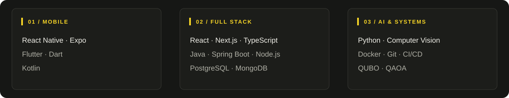

  

  
  
  
  

 

### The engineer behind TK.

I'm **Taha Göktuğ Karaca**, a software engineer building products across **mobile, web and intelligent systems**. I care about the whole experience: how it looks, how it works and how it performs in production.

- **Mobile** — cross-platform experiences with React Native, Expo and Flutter.
- **Full stack** — interfaces, APIs and real-time backends that work together.
- **Applied AI** — computer vision and tools that turn data into useful decisions.
- **Beyond the usual** — interactive 3D experiences and hybrid quantum optimization.

 

### My toolkit.

 

### Things I build.

| Project | Focus |
| :--- | :--- |
| **[Sarı Araba Online](https://sariaraba.com.tr)** | A mobile car marketplace simulation with interactive driving and 3D experiences. |
| **Yaprak** | Agricultural decision support connecting field observations, AI and expert review. |
| **SentinelTK** | Fraud detection and user protection with browser tooling and AI. |
| **Lunar Landing Site Navigator** | Lunar mission planning with energy, communication and hybrid optimization. |

<a href="https://www.tahakaraca.com/">Explore my work ↗</a>

 

  

